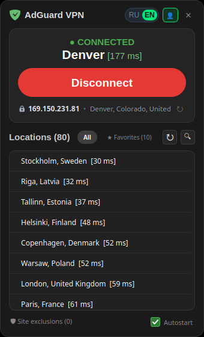

# AdGuard VPN GUI для Linux

Окно в трее над официальной консольной программой `adguardvpn-cli`.
Показывает, подключён ли VPN, к какому городу, с каким пингом и под каким
IP. Подключает и отключает в один клик. Ничего не делает сама: каждая
кнопка вызывает ту команду, которую вы набрали бы в терминале.



Страница проекта: https://iresultman.github.io/adguardvpn-Linux-gui/

[English version](README.en.md)

*In English: a tray GUI for Linux on top of the official AdGuard VPN CLI.
It mirrors `adguardvpn-cli status`, `list-locations`, `connect`,
`disconnect`, `login` and `site-exclusions`, and adds nothing of its own.
See the [English summary](#in-english) at the end.*

## Зачем

У AdGuard VPN нет графической программы для Linux, только CLI. Я не хочу
помнить команды и держать терминал открытым, чтобы узнать, работает ли VPN.
Без VPN работать невозможно, поэтому его состояние должно быть видно всегда,
как заряд батареи: одна иконка в трее, одно окно по клику. Так появилась эта
оболочка.

## Что показывает и умеет

- Состояние подключения и город, к которому подключён VPN, с пингом.
- Публичный IP и его геолокацию. Клик по IP копирует его в буфер.
- Список из 80+ локаций с пингами, сортировка по пингу, поиск, избранное.
- Подключение к локации двойным кликом или кнопкой.
- Исключения сайтов: просмотр, добавление, удаление, текущий режим
  (GENERAL или SELECTIVE).
- Вход в аккаунт через браузер и выход из него, тариф и срок подписки.
- Автозапуск при входе в систему, русский и английский интерфейс.
- Иконка в трее меняется вместе с состоянием, подсказка показывает город.

## Как это устроено

GUI не содержит собственной VPN-логики. Фоновый поток раз в 2 секунды
вызывает `adguardvpn-cli status` и показывает ответ. Всё остальное тоже
вызовы CLI:

| Действие в окне | Команда |
|---|---|
| Состояние, город (каждые 2 с) | `adguardvpn-cli status` |
| Аккаунт и тариф (каждые 30 с) | `adguardvpn-cli license` |
| Список локаций и пинги | `adguardvpn-cli list-locations` |
| Кнопка «Подключиться» | `adguardvpn-cli connect -y` |
| Двойной клик по локации | `adguardvpn-cli connect -l "<город>" -y` |
| Кнопка «Отключиться» | `adguardvpn-cli disconnect` |
| Вход и выход | `adguardvpn-cli login`, `adguardvpn-cli logout` |
| Исключения сайтов | `adguardvpn-cli site-exclusions show / add / remove / clear` |

Единственное, что не идёт через CLI, это публичный IP: он запрашивается
по HTTPS у `ipwho.is`, а при сбое у `ipapi.co`.

Если VPN поднят другим способом (например, systemd-юнитом при загрузке),
окно покажет и это: оно читает состояние того же демона.

## Установка

Нужны: Linux, Python 3.8+ с модулем `venv`, установленный и авторизованный
[AdGuard VPN CLI](https://github.com/AdguardTeam/AdGuardVPNCLI), трей.

```bash
git clone https://github.com/iResultMan/adguardvpn-Linux-gui.git
cd adguardvpn-Linux-gui
./install.sh
```

Скрипт создаёт `venv` с PyQt5, ярлык в меню приложений, иконки и
автозапуск. Запуск вручную:

```bash
venv/bin/python AdGuard.py
```

`--minimized` запускает сразу в трей (так делает автозапуск).

**GNOME.** В GNOME Shell трея нет, нужно расширение AppIndicator:
пакет `gnome-shell-extension-appindicator` в Ubuntu, Debian и Fedora.
Без трея окно просто показывается при запуске.

**KDE, Xfce, Cinnamon, MATE, LXQt** работают без дополнений.

## Справка

| Что | Как |
|---|---|
| Открыть или спрятать окно | клик по иконке в трее, повторный запуск программы |
| Спрятать окно | `Esc`, крестик, клик мимо окна |
| Выйти из программы | `Ctrl+Q` или меню аккаунта (иконка человека) |
| Подключиться к локации | двойной клик по строке, либо выделить и нажать «Подключиться» |
| Добавить в избранное | правая кнопка мыши по локации |
| Поиск по локациям | кнопка с лупой, `Esc` закрывает |
| Обновить пинги | кнопка со стрелкой рядом с лупой |
| Сменить язык | переключатель RU / EN в заголовке |
| Автозапуск | флажок внизу окна |

Файлы программы в домашней папке:

| Файл | Что хранит |
|---|---|
| `~/.config/adguard-gui-settings.json` | язык |
| `~/.config/adguard-gui-favorites.json` | избранные локации |
| `~/.config/adguard-locations-cache.json` | список локаций для мгновенного старта |
| `~/.config/autostart/adguard.desktop` | автозапуск |

### Автоподключение при загрузке

Необязательно. Если хочется, чтобы VPN поднимался ещё до входа в систему,
в `systemd/adguardvpn.service.example` лежит системный юнит, которым
пользуюсь я. Инструкция внутри файла. Окно увидит это подключение так же,
как любое другое.

## Ограничения

- **Положение окна на Wayland.** Wayland не сообщает программам, где
  находится их иконка в трее и даже где курсор. Поэтому на Wayland окно
  открывается у правого края панели (там живут индикаторы во всех
  оболочках), а не точно под иконкой. На X11 окно встаёт под курсор.
  Для этого программа работает через XWayland, если он есть.
- Только Linux. На macOS и Windows у AdGuard есть собственные приложения.
- Первый `connect` может попросить настроить права (CAP_NET_ADMIN).
  Сделайте это один раз в терминале: `adguardvpn-cli connect`.

## Разработка

```
AdGuard.py        всё приложение, один файл
assets/           иконки окна и трея
tests/            тесты парсеров вывода CLI и расчёта положения окна
tools/            установка иконок в тему hicolor
systemd/          пример юнита автоподключения
design/           эскизы иконок (история, в работе не нужны)
docs/             страница GitHub Pages
```

Тесты не требуют дисплея:

```bash
QT_QPA_PLATFORM=offscreen venv/bin/python -m unittest discover -s tests -v
```

Тесты собраны на реальном выводе AdGuard VPN CLI 1.7.12. Если новая версия
CLI изменит формат, упадут они, а не окно.

Страница проекта публикуется из папки `docs/` ветки `main`: Settings →
Pages → Deploy from a branch → `main` / `docs`.

## In English

A tray front-end for Linux over the official `adguardvpn-cli`. The window
polls `adguardvpn-cli status` every 2 seconds and shows the result:
connection state, city, ping, public IP. Buttons run `connect -y`,
`connect -l "<city>" -y`, `disconnect`, `login`, `logout` and
`site-exclusions`. Nothing else. Install with `./install.sh` (creates a
venv with PyQt5, a menu entry and an autostart entry); GNOME needs the
AppIndicator extension for the tray icon. On Wayland the window opens at
the right end of the panel because Wayland hides the tray icon position
from applications; on X11 it opens under the cursor.

AdGuard и AdGuard VPN — товарные знаки AdGuard Software Ltd. Этот проект
независимый и не связан с AdGuard.

## Лицензия

MIT, см. [LICENSE](LICENSE).
